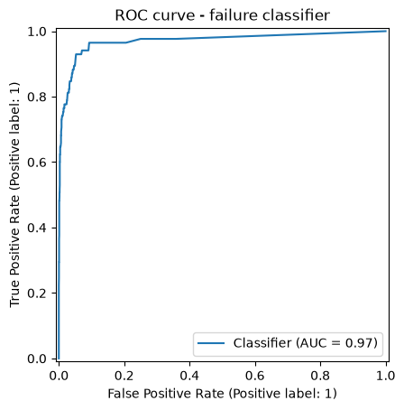

# Predictive Maintenance: Clustering + Failure Classification

Characterize a machine's operating regime from live sensor readings and flag it as at risk of failure before it happens — clustering and classification wired into one pipeline, where the cluster a machine falls into is itself used as an input to the failure classifier.

Dataset: [AI4I 2020 Predictive Maintenance Dataset](https://archive.ics.uci.edu/dataset/601/ai4i+2020+predictive+maintenance+dataset) (UCI Machine Learning Repository), 10,000 operating cycles. Each row has 5 sensor readings (air and process temperature, rotational speed, torque, tool wear), a product quality variant (`L`/`M`/`H` — low/medium/high, 60%/30%/10% of the data), and whether a failure occurred (~3.4% of cycles). The quality variant isn't just a label: failure rate drops from 3.9% (`L`) to 2.8% (`M`) to 2.1% (`H`) in the raw data, so lower-quality units genuinely fail more often.

## Results

| Metric | Value |
|---|---|
| Clustering (KMeans, k=3) | silhouette ≈ 0.26 |
| Failure classifier — ROC-AUC | ≈ 0.97 |
| Failure classifier — minority-class F1 | ≈ 0.73 |
| Failure classifier — minority-class precision / recall | ≈ 0.75 / 0.72 |

Clustering surfaced three physically interpretable regimes: one **high-speed / low-torque** regime, and two **low-speed / high-torque** regimes differing mainly by temperature and tool wear. Classifier metrics are reported on the minority (failure) class rather than overall accuracy, since the ~3.4% failure rate makes accuracy uninformative on its own.

## Approach

1. **Cleaning** – drop row identifiers and the failure-mode flag columns (`TWF`, `HDF`, `PWF`, `OSF`, `RNF`), which are sub-components of the target itself and would otherwise leak it.
2. **Encoding and split** – ordinal encoding of the product quality variant (L/M/H); stratified train/test split performed *before* any fitting, to avoid leakage.
3. **Scaling** – `StandardScaler` fit on the train set only.
4. **Clustering** – KMeans on the scaled sensor readings, k chosen by silhouette score, fit on train and applied via `.predict` on test; clusters profiled by their original (unscaled) feature means to describe each regime in physical terms.
5. **Classification** – Random Forest predicting machine failure from the sensor features, the quality variant, *and* the cluster assignment as an extra feature, with `class_weight='balanced'` to handle the class imbalance.
6. **Persistence** – every fitted component (encoder, scaler, KMeans model, cluster encoder, classifier) saved via `joblib`, so the pipeline can score new data without retraining.

## Repository

- `data/ai4i2020.csv` – the dataset.
- `predictive_maintenance.ipynb` – full pipeline: EDA, cleaning, clustering, classification, persistence.

Running the notebook end to end regenerates `model.pkl`, the saved pipeline.

## Tech stack

Python · pandas · NumPy · scikit-learn · Matplotlib · joblib
